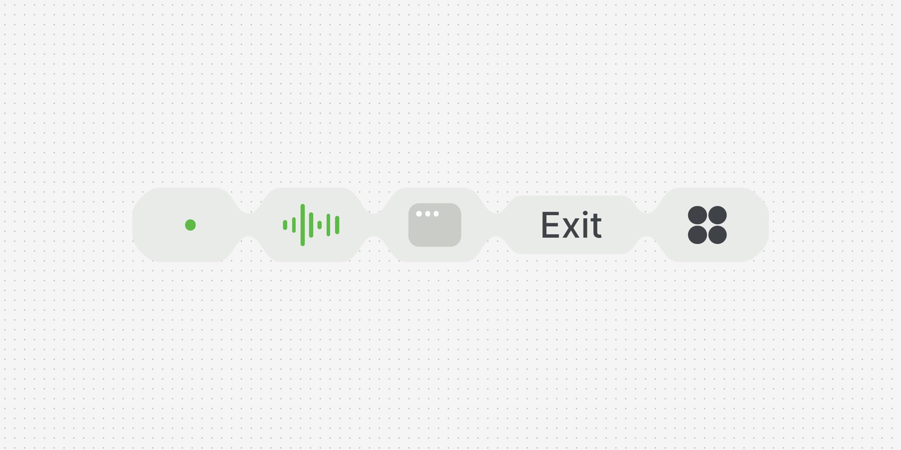
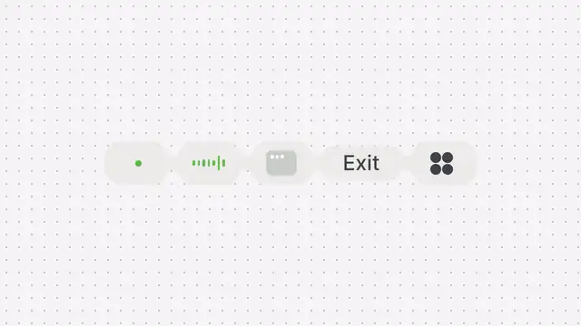

<p align="center">
  
</p>

<p align="center">
  <a href="https://likemiens.com/ui/voice-dock"><b>Live demo</b></a> ·
  <a href="media/demo.mp4"><b>Video</b></a> ·
  <a href="#quick-start"><b>Quick start</b></a>
</p>

<p align="center">
  Made by Likemiens ·
  <a href="https://x.com/a_varantsov">X</a> ·
  <a href="https://t.me/Likemiens">Telegram</a> ·
  <a href="https://github.com/Likemiens">GitHub</a>
</p>

**Voice Dock** is the control bar of a live voice session: the connection, the microphone, screen sharing, Exit and a menu, drawn as beads on one thread.

It is a React component in two files. It only draws: your app keeps the call, and the dock tells you what the user pressed.

<p align="center">
  
</p>

## Features

- **Beads on one thread.** One outline on springs. A bead swells under the pointer and bounces when you toggle it, Exit stretches to fit its question, and an ended call folds into a single bead.
- **Follows the voice.** Seven bars move with the level you pass. Muting draws a slash that cuts through them. Pass a function, and the bars move without re-rendering React.
- **Exit asks once more.** The first press turns Exit into a question, the second one ends the call. If nothing happens, it lets go after 4 seconds.
- **Keyboard and screen readers.** One Tab stop, arrow keys between the beads, Esc to step back. Status changes are announced, and every word comes from you.
- **Three sizes, your colours.** 48, 42 or 36 px high, and the tooltips keep their size. Seven CSS custom properties for the colours.
- **Light.** No dependencies besides React 19.2. It rests while off-screen and respects "reduce motion".

## Quick start

Copy `voice-dock.tsx` and `voice-dock.css` into your project, side by side. Or fetch the folder:

```bash
npx degit Likemiens/voice-dock components/voice-dock
```

Then give it your call's state:

```tsx
import { useState } from "react";
import { VoiceDock, type VoiceDockLabels } from "./voice-dock"; // brings voice-dock.css with it

const labels: VoiceDockLabels = {
  dock: "Voice session",
  connecting: "Connecting",
  live: "Connected",
  reconnecting: "Reconnecting",
  ended: "Ended",
  mute: "Mute",
  unmute: "Unmute",
  share: "Share screen",
  unshare: "Stop sharing",
  exit: "Exit",
  confirm: "Sure?",
  confirmExit: "Confirm exit",
  more: "More",
};

export function CallBar({ call }) {
  const [muted, setMuted] = useState(false);
  const [sharing, setSharing] = useState(false);
  const [menuOpen, setMenuOpen] = useState(false);

  return (
    <VoiceDock
      status={call.status} // "connecting" | "live" | "reconnecting" | "ended"
      muted={muted}
      sharing={sharing}
      menuOpen={menuOpen}
      level={() => call.level()} // 0…1, read every frame
      labels={labels}
      onMutedChange={setMuted}
      onSharingChange={setSharing}
      onMenuOpenChange={setMenuOpen}
      onExit={() => call.leave()}
    />
  );
}
```

The dock shows what you pass. A press only calls back: pass the new value in, or nothing changes. [example.tsx](example.tsx) is a complete version with a menu.

> [!NOTE]
> **Next.js:** `voice-dock.tsx` already starts with `"use client"`. It takes functions (`level` and the callbacks), so render it from a client component: put `"use client"` at the top of the file with `CallBar`.

### The menu is yours

The More bead only reports. `menuOpen` turns its four dots, and `onMenuOpenChange` says it was pressed. Render the menu yourself. More is the last bead, so a menu aligned to the right edge of the dock sits right above it:

```tsx
<div style={{ position: "relative", display: "inline-flex" }}>
  <VoiceDock status={status} labels={labels} menuOpen={menuOpen} onMenuOpenChange={setMenuOpen} />
  {menuOpen && (
    <div style={{ position: "absolute", right: 0, bottom: "calc(100% + 12px)" }}>
      <YourMenu onClose={() => setMenuOpen(false)} />
    </div>
  )}
</div>
```

## Props

| Prop | Type | Default | What it does |
|---|---|---|---|
| `status` | `"connecting" \| "live" \| "reconnecting" \| "ended"` | required | The session, shown by a dot and its word. A live session shows the dot alone. Until it is live, the microphone and screen beads are disabled. `"ended"` folds every bead into the first. |
| `muted` | `boolean` | `false` | The microphone is off: a slash is drawn across the waveform. |
| `sharing` | `boolean` | `false` | The screen is shared: the window turns green. |
| `menuOpen` | `boolean` | `false` | The More bead is open. The menu itself is yours to render. |
| `level` | `number \| (() => number)` | `0` | The voice, 0…1. A function is read every frame, so a meter re-renders nothing. |
| `armed` | `boolean` | — | Exit waits for its second press. Leave it out and the dock keeps it itself, letting go after 4 s. |
| `size` | `36 \| 42 \| 48` | `48` | The height of a bead. The whole dock scales, and tooltips keep their size. Live, it is about 412, 361 or 309 px wide. |
| `labels` | `VoiceDockLabels` | required | Every word the dock shows or says to a screen reader. |

### Labels

All of them are required:

| Label | Where it goes |
|---|---|
| `dock` | the name of the toolbar, for screen readers |
| `connecting`, `reconnecting`, `ended` | the word next to the dot; screen readers hear it too |
| `live` | for screen readers only: a live dock shows just its dot |
| `mute`, `unmute` | the microphone's tooltip; `mute` is also its name |
| `share`, `unshare` | the screen's tooltip; `share` is also its name |
| `exit` | the Exit bead |
| `confirm` | Exit after its first press, like "Sure?" |
| `confirmExit` | what a screen reader hears then |
| `more` | the menu bead and its tooltip |

## Callbacks

| Callback | When it is called |
|---|---|
| `onMutedChange(muted)` | The microphone was pressed. |
| `onSharingChange(sharing)` | The screen was pressed. |
| `onMenuOpenChange(open)` | The More bead was pressed, or Esc closed the menu. |
| `onArmedChange(armed)` | Exit asks once more, or lets go. |
| `onExit()` | The second press of Exit. Set `status` to `"ended"` to fold the dock. |

## Styling

Colours come from CSS custom properties, set on the dock or on any parent. These are the defaults:

```css
.call {
  --vd-surface: #eaebe9; /* the beads */
  --vd-ink: #3f4247;     /* words, the slash, the menu dots */
  --vd-quiet: #caccc9;   /* the bars and the window at rest, the dot of an ended call */
  --vd-live: #5eb948;    /* the live dot, a talking voice, a shared screen */
  --vd-warn: #e8a13a;    /* the dot while connecting or reconnecting */
  --vd-danger: #e5484d;  /* the question on Exit */
  --vd-focus: #0c75f1;   /* the keyboard focus ring */
}
```

The dock uses your page's font and measures its words in it, so Exit always fits its word. Nothing glows: a state is shown by colour and by motion.

## Keyboard

The dock is one Tab stop.

| Key | What it does |
|---|---|
| `←` `→` | move between the beads |
| `Home` `End` | go to the first or the last bead |
| `Enter` `Space` | press |
| `Esc` | take Exit back, or close the menu |

## Files

```
voice-dock.tsx   the component and its types
voice-dock.css   icons, words, tooltips and colours
example.tsx      a call bar with a menu, to start from
AGENTS.md        notes for coding agents
media/           the cover, the preview and the video
```

## Author

Made by **Likemiens**. Say hi or share what you built: [X](https://x.com/a_varantsov) · [Telegram](https://t.me/Likemiens) · [GitHub](https://github.com/Likemiens)

## License

[MIT](LICENSE) © Likemiens
